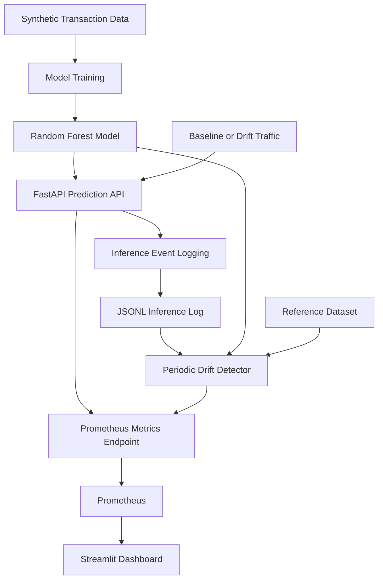

# SentinelML — Model Monitoring & Drift Detection

SentinelML is a machine-learning monitoring project that serves synthetic transaction fraud predictions through FastAPI, records inference events, detects changes in input and prediction distributions, and exposes monitoring metrics to Prometheus through an interactive Streamlit dashboard.

The project demonstrates how an ML model can be monitored after deployment rather than treated as a one-time training exercise.

## Key Features

- Synthetic transaction dataset generation and fraud classification using Random Forest.
- REST API for transaction predictions using FastAPI.
- Inference latency, prediction counts, and prediction error metrics.
- JSONL-based inference event logging.
- Periodic data drift and prediction drift analysis.
- Statistical comparisons using the Kolmogorov–Smirnov (KS) test and Population Stability Index (PSI).
- Prometheus metrics collection and an interactive Streamlit monitoring dashboard.
- Baseline and deliberately shifted synthetic traffic for testing drift detection.
- Automated tests for drift calculations, malformed logs, and insufficient-data handling.

## Architecture



## Technology Stack

| Component | Technology |
|---|---|
| Language | Python |
| Model training | scikit-learn, pandas, NumPy |
| Model persistence | Joblib |
| Inference API | FastAPI, Uvicorn |
| Statistical drift detection | SciPy, NumPy |
| Event logging | JSON Lines (JSONL) |
| Metrics instrumentation | prometheus-client |
| Metrics collection | Prometheus |
| Visualization | Streamlit, pandas |
| Testing | pytest |

## Project Structure

```text
SentinelML/
├── src/
│   ├── api/
│   │   ├── main.py
│   │   └── inference_logger.py
│   ├── monitor/
│   │   ├── drift_detector.py
│   │   └── generate_traffic.py
│   └── training/
│       └── train.py
├── tests/
│   └── test_drift_detector.py
├── data/
│   ├── raw/
│   └── reference/
├── models/
├── logs/
├── streamlit_app.py
├── prometheus.yml
├── requirements.txt
└── .gitignore
```

Generated datasets, trained model files, and runtime logs are intentionally excluded from Git. The training script generates the required artifacts locally.

## Prerequisites

- Windows 10 or Windows 11
- Python 3.12 or a compatible Python version
- Git
- Prometheus for Windows

Streamlit is installed as a Python package through `requirements.txt`. Prometheus must be installed separately.

## Setup

### 1. Clone the repository

```powershell
git clone https://github.com/aditig-byte/SentinelML.git
cd SentinelML
```

### 2. Create a virtual environment

```powershell
py -3.12 -m venv .venv
.\.venv\Scripts\Activate.ps1
```

If PowerShell blocks virtual-environment activation, run:

```powershell
Set-ExecutionPolicy -Scope Process -ExecutionPolicy RemoteSigned
.\.venv\Scripts\Activate.ps1
```

Alternatively, run the virtual environment's Python executable directly.

### 3. Install dependencies

```powershell
python -m pip install --upgrade pip
python -m pip install -r requirements.txt
```

### 4. Train the model

```powershell
python -m src.training.train
```

Training generates the synthetic dataset, trained model, model metadata, and reference dataset required by the monitoring pipeline.

Confirm that the expected files have been created under `data/` and `models/` before continuing.

## Run the API

Start the inference service from the project directory:

```powershell
python -m uvicorn src.api.main:app --reload
```

The API runs locally at:

`http://127.0.0.1:8000`

Useful endpoints:

| Endpoint | Purpose |
|---|---|
| `/` | API information |
| `/health` | Health check |
| `/docs` | Interactive API documentation |
| `/predict` | Transaction prediction endpoint |
| `/metrics` | Prometheus metrics |
| `/monitor/status` | Current monitoring status |

Open `http://127.0.0.1:8000/docs` to inspect the request schema and try a prediction.

The prediction request uses these six features:

- `amount`
- `hour`
- `distance_from_home`
- `international`
- `merchant_risk`
- `transactions_last_24h`

The response includes the predicted class, label, fraud probability, and inference latency.

## Generate Traffic

Keep the API running in its own PowerShell terminal. Run traffic-generation commands from another terminal in the project directory, with the virtual environment activated.

### Baseline traffic

```powershell
python -m src.monitor.generate_traffic --mode baseline --count 100
```

Baseline traffic uses distributions intended to resemble the training data.

### Drift traffic

```powershell
python -m src.monitor.generate_traffic --mode drift --count 100
```

Drift mode deliberately shifts selected transaction features to exercise the monitoring pipeline.

Check the generator output for successful and failed requests.

## Drift Detection

The drift detector compares a reference dataset with recent inference events.

Run it manually with:

```powershell
python -m src.monitor.drift_detector
```

Optional parameters:

```powershell
python -m src.monitor.drift_detector --window-size 100 --min-samples 30
```

The API also runs drift analysis periodically and publishes its status through Prometheus metrics.

### Data drift

Data drift refers to changes in the input feature distribution, commonly described as a change in \(P(X)\).

SentinelML compares the reference and current distributions for the six transaction features.

### Prediction drift

Prediction drift refers to changes in the model's output distribution, such as changes in the distribution of predicted fraud probabilities.

A change in prediction distribution does not, by itself, prove that model accuracy has decreased.

### Concept drift

Concept drift refers to a change in the relationship between inputs and outcomes, commonly described as a change in \(P(Y \mid X)\).

SentinelML does not independently establish concept drift because the monitoring pipeline does not receive ongoing ground-truth labels to evaluate that relationship.

### Statistical methods

**Kolmogorov–Smirnov (KS) test:** compares two empirical distributions. A p-value below 0.05 provides evidence against the null hypothesis that the samples come from the same distribution.

**Population Stability Index (PSI):** quantifies differences in binned distributions using bins based on reference-data quantiles.

The configured PSI thresholds are:

| PSI | Interpretation |
|---|---|
| Below 0.10 | No PSI warning |
| 0.10 to below 0.20 | Warning |
| 0.20 or above | Drift threshold reached |

These thresholds are heuristics, not universal guarantees. The KS test and PSI capture different aspects of distribution changes.

## Prometheus Setup

The repository includes `prometheus.yml` configured to scrape the local API every five seconds.

Example configuration:

```yaml
global:
  scrape_interval: 5s

scrape_configs:
  - job_name: "sentinelml"
    metrics_path: /metrics
    static_configs:
      - targets: ["127.0.0.1:8000"]
```

Ensure the API is running before starting Prometheus.

For the Windows installation used during development, open a separate PowerShell terminal and run:

```powershell
cd "C:\tools\prometheus"
.\prometheus.exe --config.file="C:\tools\prometheus\prometheus.yml"
```

If Prometheus is installed elsewhere, replace the paths with the appropriate locations and ensure the configuration points to the API's `/metrics` endpoint.

Open:

`http://localhost:9090`

Verify the target under **Status → Targets**. The `sentinelml` target should be `UP`.

Useful metrics include:

- `sentinelml_predictions_total`
- `sentinelml_inference_latency_seconds`
- `sentinelml_prediction_errors_total`
- `sentinelml_data_drift_status`
- `sentinelml_prediction_drift_status`
- `sentinelml_overall_drift_status`
- `sentinelml_feature_psi`
- `sentinelml_drift_analysis_success`
- `sentinelml_drift_analysis_errors_total`

The status gauges use `-1` for unknown or insufficient data, `0` for OK/no drift, `1` for warning, and `2` for detected drift.

## Streamlit Dashboard

SentinelML includes an interactive Streamlit dashboard that queries Prometheus and displays the available monitoring metrics.

Start FastAPI and Prometheus in separate PowerShell terminals first. Then open a third terminal in the project directory, activate the virtual environment, and run:

```powershell
python -m streamlit run streamlit_app.py
```

Open the dashboard at:

`http://localhost:8501`

The dashboard queries Prometheus at `http://localhost:9090`. Ensure the Prometheus server is running and the `sentinelml` target is `UP`.

The dashboard includes:

1. **Model Health Overview** — prediction activity and overall, data, and prediction drift status.
2. **Feature Drift** — feature-level PSI values, drift interpretation, and available history.
3. **Performance** — inference latency and available error metrics.
4. **How It Works** — explanations of the monitoring pipeline and key concepts.

Dashboard history depends on the samples retained by Prometheus. Historical charts require sufficient collected samples. The dashboard runs locally and is not automatically deployed to a public hosting service.

## End-to-End Demo

Start FastAPI, Prometheus, and Streamlit in three separate PowerShell terminals.

In a fourth terminal, activate the virtual environment and generate baseline traffic:

```powershell
cd "C:\Users\Aditi Gupta\SentinelML"
.\.venv\Scripts\Activate.ps1
python -m src.monitor.generate_traffic --mode baseline --count 100
```

Inspect the dashboard at `http://localhost:8501`.

Then generate deliberately shifted traffic:

```powershell
python -m src.monitor.generate_traffic --mode drift --count 100
```

Refresh the dashboard and inspect the Feature Drift and Model Health Overview pages.

Drift status depends on the configured analysis interval and minimum sample requirements. Allow sufficient time for the API to analyze new events and for Prometheus to scrape updated metrics.

## Automated Tests

Install the dependencies, then run:

```powershell
python -m pytest -v
```

The tests cover PSI calculations, large distribution shifts, invalid samples, malformed inference-log records, missing logs, and insufficient monitoring data.

## Limitations

- The fraud dataset and labels are synthetic and do not establish real-world fraud detection performance.
- Input drift and prediction drift are not proof of reduced model accuracy.
- Concept drift cannot be confirmed without suitable ground-truth outcome data.
- Inference events are stored in a local JSONL file rather than Kafka.
- Runtime logs and model artifacts are excluded from Git and must be regenerated or supplied locally.
- Prometheus stores its own time-series data; monitoring history and counters may reset or be lost depending on local configuration and restarts.
- The drift detector runs as a periodic background task in the API process.
- Production deployment would require durable event storage, suitable metric ingestion, access controls, and operational alerting.

## Future Improvements

- Deploy the API and monitoring stack to cloud infrastructure.
- Add durable event streaming with Kafka or another messaging platform.
- Integrate labeled outcomes for model performance monitoring.
- Configure alert delivery for significant drift and service failures.
- Add dashboard provisioning and automated deployment configuration.
- Introduce persistent storage and more comprehensive integration tests.

## Disclaimer

SentinelML is an educational MLOps and observability project built using synthetic transaction data. It demonstrates model-serving and monitoring techniques and is not intended to provide production-ready financial fraud decisions.
